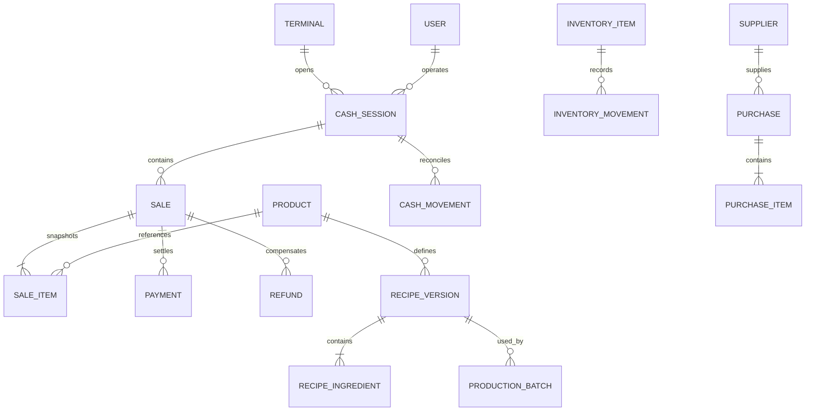

# Modelo de datos

## Implementado — migración 001

| Tabla | Clave y restricciones |
|---|---|
| schema_migration | versión PK, SHA-256 y fecha UTC |
| terminal | ID TEXT PK (GUID en aplicación), nombre no vacío, creación UTC |
| category | ID PK, nombre no vacío y active 0/1 |
| product | ID PK, SKU opcional único, nombre, FK restrict a categoría, descripción, precio centavos >=0, flags 0/1, creación/modificación UTC |

Tablas STRICT; índice de categoría y SKU parcial único. No hay seeds. GUID y fechas se representarán como texto canónico desde aplicación; el esquema actual no valida su formato. El precio usa INTEGER SQLite de 64 bits. Las fechas UTC usan ISO 8601. No hay tabla de stock mutable ni ventas prematuras.

## Evolución propuesta — salvo identidad y sesión implementadas en 002

Sale tendrá GUID, folio único por ámbito documentado, terminal, usuario, caja, UTC, estado, moneda, totales y clave idempotente única. FK e índices por sesión, fecha y origen. SaleItem conserva snapshots incluso si el producto se desactiva. Payment tiene método e importe; múltiples filas posibles desde el esquema, aunque la UI inicial use uno.

Sesión: el índice parcial implementado en 002 utiliza state = OPEN; las operaciones futuras de venta/cierre deberán comprobar caja abierta dentro de su transacción. Movimientos de caja con referencia única de operación para impedir duplicación. Ledger de stock referenciable mediante InventoryItem; definir integridad de origen sin depender de un string libre.

Producción referencia versión de receta y conserva cantidades/costos efectivos. Compra y merma generan movimientos en la misma transacción. Auditoría persiste acción, actor, entidad, ID, antes/después cuando corresponde, UTC y terminal. Trabajos de impresión locales persistidos junto con venta; no es infraestructura distribuida.

Backups: cada archivo único es una instantánea validada por integrity_check y foreign_key_check. Restaurar a archivo nuevo y comprobar consultas de negocio antes de activarlo. La base local no está cifrada; tampoco sus backups. Elegir almacenamiento protegido y segunda copia antes de producción. No prometer resistencia frente a un administrador con acceso físico.

## Implementado — migración 002 (FASE 1A)

La migración 001 permanece intacta. 002 añade app_role, permission, role_permission, app_user, cash_session y audit_entry. Los roles y sus permisos son seed de referencia; no se insertan usuarios ni contraseñas predeterminadas.

app_user tiene nombre normalizado único, hash, rol FK, activo y estado persistido de bloqueo. cash_session referencia terminal y usuario de apertura/cierre; almacena fondo en centavos, UTC y estado OPEN/CLOSED. Los campos de efectivo esperado/contado/diferencia y cierre quedan nullable hasta FASE 1B. Checks exigen fondo >= 0 y metadatos de estado coherentes.

La restricción real es ux_cash_one_open_terminal: UNIQUE(terminal_id) WHERE state = 'OPEN'. Junto con la transacción inmediata protege frente a carreras. Un trigger rechaza reabrir CLOSED mediante UPDATE directo; Domain no expone setters ni operación de reapertura.

Auditoría separada de logs: actor, terminal opcional para bootstrap, acción, entidad, UTC y detalles JSON mínimos. FK, índice temporal y unicidad de cash.open por entidad. Triggers rechazan UPDATE/DELETE de auditoría. No protegen contra un administrador que altera el esquema.

Se probaron base vacía, upgrade 001→002, concurrencia con conexiones reales, restricciones SQL directas y rollback de sesión cuando falla auditoría. Terminal configurada en terminal.json con GUID estable; conservar ese archivo al respaldar/restaurar una instalación. El backup SQLite actual no lo incluye.

## Migración 003 — conteo y cierre

001 y 002 siguen inmutables. Se añade cash.close.other para Administrator/Manager y cash_count(session_id PK/FK, counted_by FK, counted_utc, counted_cents>=0). No se duplica closed_by_other: se deriva de closed_by != opened_by, y la auditoría lo hace explícito.

Conteo sólo sobre OPEN y sin UPDATE/DELETE. Cierre requiere valores financieros presentes, no negativos para esperado/contado y diferencia coherente. UPDATE/DELETE sobre CLOSED prohibidos; el trigger de 002 contra reapertura sigue vigente. Unicidad de auditorías cash.count y cash.close por sesión. Los cierres históricos anteriores, si los hubiera, no se rellenan inventando importes.

No hay nuevas tablas de ventas, pagos, movimientos o catálogo. cash_session conserva columnas de cierre existentes. SubmitCount y Close usan transacciones separadas con su propia auditoría; Close hace UPDATE WHERE state='OPEN' y exige una fila afectada. El audit de cierre contiene propietario, cerrador, contador, UTC, fondo, esperado, contado y diferencia.

Se verifica upgrade de v2 con sesión abierta a v3 y cierre posterior. Backup completo verifica relación terminal.json con terminal.id/name y preserva todo el historial. Consultar operations.md; un .db legado solo no cubre terminal.

## Migración 004 — catálogo base

001–003 permanecen intactas. Category añade description, sort_order, created_utc y modified_utc. Las fechas de categorías heredadas toman applied_utc de 001 como referencia de migración porque no había fecha comercial; no se inventa un origen conocido. Product reutiliza columnas existentes: price_cents INTEGER Int64, SKU nullable, flags, fechas y FK.

ux_category_name y ux_product_sku_normalized son UNIQUE sobre catalog_key_v1; incluyen registros inactivos y omiten SKU NULL. Database.Open registra función determinista y collation CATALOG_KEY_V1. Trim/NFC/mayúscula invariante preserva acentos; contrato versionado ADR-008. Herramientas externas deben registrar el mismo contrato o usar Maintenance.

Triggers category_keep_history/product_keep_history rechazan DELETE. category_active_children rechaza desactivar con hijos activos; product_active_category_insert/update rechazan producto activo en categoría inactiva. Índices ix_category_order e ix_product_active_name complementan el índice previo de category_id. Siete permisos, ambos roles administradores completos y Cashier sólo vista.

Preflight dentro de transacción rechaza conflictos previos de normalización/coherencia; antes de escribir schema_migration v4 se verifica que existan los nueve índices/triggers requeridos. No se alteran nombres silenciosamente ni se registra versión si hay fallo. Probado vacío, upgrade v3 con datos, conflicto legado rollback a v3, SQL directo, concurrencia y auditoría fallida.

Consultas operativas exigen producto y categoría activos. Administración permite incluir inactivos, filtro category_id y subcadena normalizada de nombre/SKU. LIMIT 50/OFFSET, orden nombre normalizado/ID, total de filas; prueba de 2,000 productos. Búsqueda de subcadena escanea candidatos, sin promesa de latencia ni FTS. Las categorías se cargan como lista de selección.

.cmbackup conserva formato: SQLite contiene catálogo y auditoría, terminal.json mantiene identidad. Restauración de catálogo y precio probada con test y CLI sobre smoke; copia restaurada igual al origen. El backup SQLite legado mencionado en 1A fue reemplazado por paquete completo en 1B.

## Migración 005 — permiso operacional POS

Agrega únicamente permission(pos.use) y sus concesiones a Administrator, Manager y Cashier. Se justifica para separar uso operacional del permiso de administración/consulta; no agrega columnas o tablas. 001–004 permanecen intactas. Trece permisos en total, cinco migraciones.

ListPosCategories aplica active=1 y EXISTS de product activo; QueryProducts aplica actividad de ambos lados en SQL. Categorías ordenadas por SortOrder/nombre normalizado/ID; productos por nombre normalizado/ID, páginas de 50, búsqueda nombre/SKU. Prueba de 2,002 productos instrumenta llamadas para detectar consultas por cada botón.

Cart is transient and not a sale. No hay cart, sales, sale_items ni payments en SQLite. Sus mutaciones tampoco generan audit_entry. .cmbackup no cambia de formato y no incorpora el carrito; catálogo, caja, auditoría y terminal siguen restaurándose.

## Migración 006 — venta y pago en efectivo (vigente)

La descripción de venta/pago propuesta arriba queda sustituida en 1E por este esquema implementado. Cuatro tablas STRICT: sale_sequence(terminal_id PK/FK,last_value Int64); sale(id PK,operation_id UNIQUE,user_id FK,terminal_id FK,cash_session_id FK,sequence,confirmed_utc,subtotal_cents,total_cents); sale_item(sale_id FK,position,product_id FK,product_name,unit_price_cents,quantity,line_total_cents); payment(id PK,sale_id UNIQUE/FK,method CASH,applied_cents,received_cents,change_cents). Sale tiene UNIQUE(terminal_id,sequence); sale_item PK(sale_id,position) y UNIQUE(sale_id,product_id). Sólo un pago por venta.

Las FK de partidas/pago al encabezado son diferidas. Se insertan hijos antes del encabezado; el trigger sale_complete valida agregado completo, total, pago, caja OPEN sin conteo, terminal y actividad de producto/categoría. El commit rechaza huérfanos. Triggers prohíben UPDATE/DELETE y anexos después de confirmar. CHECK evita overflow de multiplicación antes de calcular el producto. SUM usa INTEGER, nunca TOTAL flotante; overflow aborta.

Checkout crea secuencia, partidas, pago, venta y audit_entry sale.completed dentro de una sola transacción inmediata. Índice único de auditoría por entidad. El permiso sales.complete se concede a Administrator, Manager y Cashier; total 14 permisos, seis migraciones. Un índice por caja permite sumar efectivo aplicado. El estado comercial es implícitamente confirmado; no hay borradores persistidos.

001–005 intactas byte por byte. .gitattributes marca migrations/*.sql -text porque los hashes aplicados dependen de sus bytes; no renormalizar scripts históricos. El backup conserva estas tablas sin cambiar .cmbackup. checkout.pending no pertenece al backup ni es un carrito serializado.

## Migración 007 — historial de ventas

Añade `sales.view`, lo concede a Administrator y Manager y crea `ix_sale_history` sobre `sale(confirmed_utc DESC,id DESC)`. No añade tablas ni columnas y no duplica el folio. Cashier queda sin acceso.

Las consultas reconstruyen el folio con terminal/sequence, cargan una sola página de 50 mediante LIMIT/OFFSET y mantienen orden estable. La ruta abre la base read-only dentro de una transacción deferred. Upgrade v6→v7, hashes 001–006 y backup/restore con 55 ventas se verificaron en pruebas y CLI.
